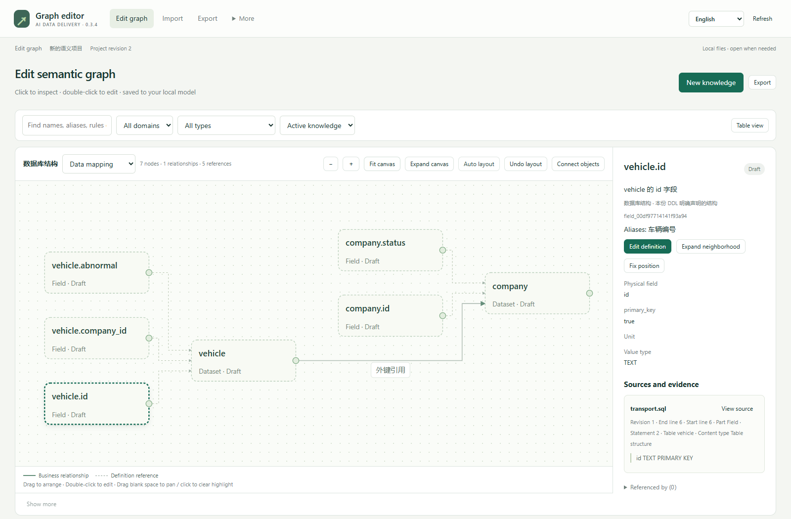

# AI Data Delivery

**Turn an existing database schema into an editable semantic model your Agent can read.**

Interactive modeling: ask your host to show the saved object and its neighborhood after the first import or a material business change. The same graph follows CLI writes while idle and preserves open forms. Create objects or relations directly; attach an imported passage or an operator statement before confirming.

[简体中文](README.zh-CN.md) · [Download 0.3.6 ZIP](https://github.com/franklinxkk/ai-data-delivery/releases/tag/v0.3.6) · [Security](SECURITY.md)

Import SQL or read a database catalog to get a draft of tables, fields and foreign keys. Enrich it with business objects, attributes and relationships. Export a source-linked semantic package that another local Agent can read through the CLI.

**CLI first; open the graph editor only when it helps.** No account, persistent service, Neo4j installation or model key is required. For data teams and Agent developers who want to reuse existing structure and add business meaning incrementally. Your host Agent reasons about documents; this tool stores, edits and delivers the model.

`Import structure → optionally inspect / edit → export or read locally`



*Actual interface using the bundled synthetic transport schema. Dashed nodes are drafts; a physical foreign key does not establish business ownership.*

## Two commands to your first model

Download the ZIP, extract it and enter the `ai-data-delivery` directory. Requires **Python 3.10+**. Install dependencies once:

```bash
python -m pip install -r requirements.txt
```

Import the bundled schema and export its draft:

```bash
python -X utf8 scripts/knowledge.py --project "./work/transport" import --file "examples/semantic-workbench/transport.sql" --seed-draft
python -X utf8 scripts/knowledge.py --project "./work/transport" export --out "./work/transport.zip" --draft
```

The result contains **2 tables, 5 fields and 1 foreign key**, with source excerpts. SQL is parsed, never executed; business rules are not guessed. Substitute your own DDL path. `--seed-draft` requires an empty model. For an existing model, omit that flag and review change candidates so manual edits remain intact.

`--draft` exports unconfirmed work with its status and gaps preserved. After reviewing and confirming definitions, omit it to export a confirmed snapshot. The output file must not already exist.

On Windows, if `python` is unavailable, check `py -3 --version` and substitute `py -3`, or use your virtual environment's Python.

## Open the graph only when needed

```bash
python -X utf8 scripts/start.py --project "./work/transport"
```

Open the printed local URL. A structure-only model opens directly in the data view. Click to inspect sources, double-click to edit, or connect objects to define a relationship. Save drafts freely; confirm definitions after review. CLI and editor use the same local model.

Use **Export** to download a package, then close the page and press **Ctrl+C** in the terminal to stop the editor. Reopen with the same project path. CLI use requires no server, saved business question or acceptance workflow.

## Let another local Agent read it

```bash
python -X utf8 scripts/semantic_read.py --package "./work/transport.zip" search --query vehicle
```

The reader returns structured JSON. Take actual IDs from search results, then use `get`, `neighbors`, `context` and `sources` for definitions, relationships, dependencies and original excerpts. Only the package is needed; the authoring project and server can be closed. [Reader guide](references/agent-reader.md)

Or tell your host Agent:

> Use ai-data-delivery to import this SQL into the specified directory as a structure draft. Use my business notes to clarify vehicles, companies and routes, retaining sources. Ask only about decisions that need my judgment. Open the graph when reviewing relationships would help, then export it for another Agent.

The host handles commands, IDs and JSON. You review business meaning. A foreign key is not automatically confirmed as company ownership.

For business semantics, the Agent can save related objects, attributes, mappings and relationships in one atomic batch. `inspect` points out unconfirmed dependencies, omitted mappings and join keys. You decide unresolved business meaning; existing authorization is reused. [Short modeling path and commands](references/modeling.md)

## Continue only as needed

| Need | Entry point |
| --- | --- |
| Connect SQLite, PostgreSQL or MySQL | [Read-only catalogs](references/readonly-metadata.md): explicit tables, structure only, no business rows |
| Add documents, metrics, rules or mappings | [Short modeling path](references/modeling.md): batch maintenance, dependency review and scoped delivery |
| Hand off a specific question with its context | [Optional question handoff](references/question-delivery.md): export with `handoff`, read with `brief` |
| Exchange with Neo4j or ontology-graph-spec | [Offline interchange](references/neo4j-interop.md); Neo4j is optional |
| Try transport, agriculture, university or finance examples | [Synthetic exercises](examples/cross-domain/README.md), not business policy |

This is a modeling and delivery tool. It does not provide multi-user administration, enterprise authorization, production queries or business execution. Core parsing and offline reading are local; optional connections use explicitly authorized endpoints. Parsing has documented limits, and packages can contain business definitions and source excerpts. [Architecture](references/architecture.md) · [Actual validation](references/v0.3.6-release-validation.md)

0.3.6 shows model changes in the open graph, protects existing assets against stale CLI edits, and keeps large-package receipts short. To update an existing asset, pass the revision you actually read before the edit command. Existing models are not automatically migrated or overwritten; back up before upgrading. Report a specific blocked step with sanitized inputs: [feedback](https://github.com/franklinxkk/ai-data-delivery/issues).

[MIT](LICENSE) · [Skill instructions](SKILL.md) · [Changelog](CHANGELOG.md)
