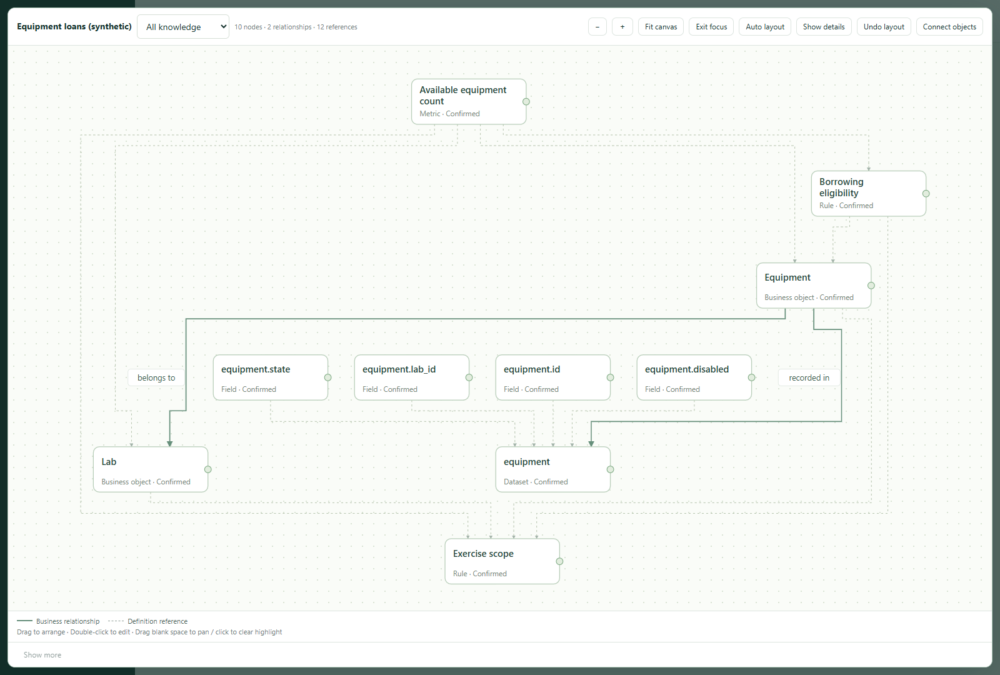

# AI Data Delivery · v0.3.0

**Turn tables, business documents and policies into one semantic graph that people can review and Agents can use.**

[简体中文](README.zh-CN.md) · [Try the example](#try-it-with-included-materials) · [Workbench guide](workbench/README.md) · [Agent reader](references/agent-reader.md)

Table names do not explain what “available” means. Documents often disagree about scope. An Agent needs those definitions and their evidence together.

AI Data Delivery helps you keep objects, terms, relationships, metrics, rules and data mappings in one graph. Review proposals against original passages, edit and arrange the graph, then hand another Agent a scoped package containing the definitions, dependencies, evidence and unanswered questions it needs.



*Real workbench screenshot from the included synthetic exercise. Solid arrows represent relationships; dotted lines represent required definition references. This is a maintained semantic model, not a production inventory dashboard.*

## One small example, end to end

| Input | Reviewed graph | What another Agent can do |
| --- | --- | --- |
| An `equipment` table with `id`, `lab_id`, `state`, `disabled` | Equipment, lab, lab assignment and a physical data mapping | Locate the business object and its declared table |
| “Lab L only; in storage and not disabled; count distinct equipment IDs” | Scope rule, eligibility rule and available-equipment metric | Explain the correct scope and count definition with source passages |
| “No inventory records or loan execution interface supplied” | An explicit knowledge gap, retained in exported context | Say what is missing instead of inventing a stock count or performing a loan |

Ask the receiving Agent: **“Can I borrow equipment from another lab? How many items can I borrow now?”**

The sample supports: “Other labs are outside this package's scope. Eligibility requires `state='in_store'` and `disabled=0` in Lab L. A current count needs inventory observations; this package contains definitions, not inventory data or borrowing authority.” This is the expected interpretation of the supplied fictional material, not a claim about a real organization.

## Try it with included materials

Requires **Python 3.10+**. Get the repository and run:

```bash
git clone https://github.com/franklinxkk/ai-data-delivery.git
cd ai-data-delivery
python -m pip install -r requirements.txt
python -X utf8 scripts/start.py --project "./work/equipment-en" --example equipment --language en
```

If you received the clean `.skill`/ZIP package, extract it and run the last two commands inside its `ai-data-delivery` directory. The `.skill` file is a ZIP archive. To register it with a host Agent, place that directory in the host's supported skills location.

Open the local URL printed in the terminal:

1. **Review table structure first** → inspect the DDL candidates and original text → **Accept whole group**.
2. Return to **Materials** → **Prepare example business proposals** → inspect scopes, rules and mapping → **Accept whole group**.
3. Open **Semantic graph**, select **All knowledge**, then **Expand canvas** and **Auto layout**. Double-click a node, edit an alias and **Save and confirm**. Refresh to inspect the saved result.
4. Open **Deliver and consume** → **Publish confirmed snapshot** → **Download semantic package**.
5. Close the workbench if you like. Give the ZIP and reader to another Agent, or run:

```bash
python -X utf8 scripts/semantic_read.py --package "./delivery/equipment.zip" verify
python -X utf8 scripts/semantic_read.py --package "./delivery/equipment.zip" search --query "available equipment"
python -X utf8 scripts/semantic_read.py --package "./delivery/equipment.zip" context --id demo.available --intent query
python -X utf8 scripts/semantic_read.py --package "./delivery/equipment.zip" sources --id demo.available
```

Replace `./delivery/equipment.zip` with the actual downloaded file. The context should include Lab L, eligibility, data mapping, source references and missing inventory/connector information. An intact package does not imply an executable query.

The example includes text, DDL and **authored proposals**, so you can inspect the complete workflow without an AI key. It is not a general text extractor. Nothing enters the confirmed graph until you review it. Reopen with the same `--project` and **omit `--example`**; initialization refuses to overwrite existing projects.

For Chinese materials and interface, use a new directory with `--example equipment --language zh`. The top-right language selector changes the interface; it preserves original materials and stored definitions. Save or clear unsaved input and close dialogs before switching. See the [中文步骤](README.zh-CN.md#直接跑通一份样例).

## Use your own knowledge

```bash
python -X utf8 scripts/start.py --project "./work/my-domain" --language en
```

Paste or upload material, then **Prepare Agent task** and give the copied instructions to your host Agent. The Agent reads sources and submits evidence-linked proposals; you review them before they become shared knowledge. You can also create knowledge manually.

> Use ai-data-delivery to model [domain] from [material paths] in [project directory]. Preserve original evidence and business scope, identify ambiguous names and unresolved questions, and submit candidates for my review. After confirmation, export a package an independent Agent can read.

| Material | Current support |
| --- | --- |
| Pasted text, TXT, Markdown | Original text with line/section locations |
| SQLite/MySQL DDL | Supported tables, columns, keys and explicit foreign keys; SQL is never executed |
| CSV, XLSX | Sheets, headers, cells and selected reading ranges; no formula recalculation |
| DOCX, text-layer PDF | Readable paragraphs/tables or page text; extraction limits reported, no OCR |
| JSON, YAML | Safe parsing; supported semantic models become proposals |

Up to **32 MB per file**. Unsupported content remains an explicit warning or conversion need. Physical foreign keys do not imply business ownership. Full input and recovery behavior: [workbench guide](workbench/README.md).

## What you can maintain and hand off

- **One graph:** objects, terms, attributes, relationships, metrics, rules, datasets, fields and mappings share stable IDs.
- **Reviewable changes:** compare current definitions, proposals and source passages; preserve accept/reject/defer decisions, source revisions and explicit identity distinctions.
- **Visual maintenance:** graph/table views, search by names or rule fields, focused neighborhoods, drag editing, automatic layout, fixed nodes and layout undo. Dense graphs can still require filtering.
- **Scoped Agent context:** search, disambiguate, retrieve required dependencies and evidence, expose declared gaps, paginate and export subgraphs. No original project or running server needed.
- **Local operation:** project SQLite and bundled browser assets; no runtime CDN, built-in LLM, API key or automatic document upload.

The semantic ZIP contains `model.json`, `sources.json`, `manifest.json`, a bilingual `human-review.html` and reading instructions. It excludes original attachments and the private project database. Models and excerpts can still contain business information: choose the intended delivery scope.

## Boundaries and verification

The host supplies semantic reasoning. This tool is not an OWL/SHACL reasoner, database query gateway, enterprise authorization system or action executor. Rules describe requirements; they do not execute them. Optional legacy numeric checks remain available under **Check numbers and details**; `--demo` is that separate exercise.

The current release's test scope and results are recorded in [v0.3.0 acceptance](references/v0.3.0-validation.md). Historical records apply only to their stated versions. External marketplace scans are separate; this README does not claim a new ClawHub or SkillHub approval.

**Before 1.0, old projects and formats are not guaranteed compatible.** Keep existing directories/backups and use a new project for this release.

[MIT license](LICENSE) · [Security boundaries](SECURITY.md) · [Changes](CHANGELOG.md) · [Candidate API contract](references/m1-m2-contract.md)
