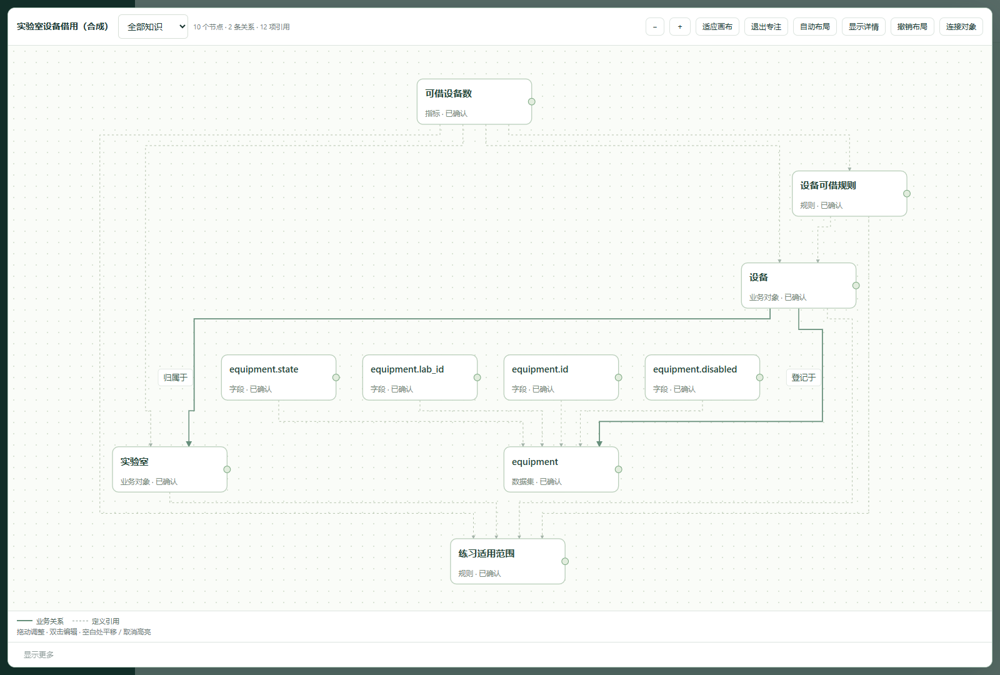

# AI Data Delivery · v0.3.1-dev

**先说清要解决的业务问题，再补齐它需要的含义，把定义、依据和边界一起交给 Agent。**

当前为开发预览。保留已发布的 v0.3.0，后续按补丁号递增。本预览增加业务问题入口、面向问题的读取路径、[四域练习](examples/cross-domain/README.md)与有限的 [OGS 导出／审计](references/neo4j-interop.md)。

[English](README.md) · [直接试用](#直接跑通一份样例) · [工作台说明](workbench/README.zh-CN.md) · [Agent 调用](references/semantic-package.md)

表名解释不了“可借”到底指什么，不同资料也可能使用不同范围。在 **业务问题** 中写下要理解、统计、查询或办理什么，复用已有定义，让宿主 Agent 根据资料补充候选，只核对会影响当前问题的决定。检查后能看清哪些含义已有依据、哪里还缺资料或执行能力。对象、指标、规则与映射仍存于同一图谱，专业编辑入口始终保留。



*v0.3.0 合成样例的图谱视图；图中未展示新增的业务问题入口。实线箭头表示关系，虚线表示定义引用；这是语义模型，不是生产库存看板。*

## 一份材料最后能带来什么

| 输入 | 核对后形成的图谱 | 独立 Agent 能提供的服务 |
| --- | --- | --- |
| equipment 表的 id、lab_id、state、disabled 字段 | 设备、实验室、归属关系和数据映射 | 找到业务对象及其对应表结构 |
| “仅实验室 L，在库且未停用，按设备编号去重” | 适用范围规则、可借规则、可借设备数指标 | 按原文解释范围和统计口径 |
| “未提供库存记录和借用执行接口” | 随上下文返回的明确缺口 | 说明还缺什么，不编造台数、不擅自办理借用 |

把包交给另一个 Agent，问：**“能借其他实验室的设备吗？现在能借几台？”**

这份样例支持的回答是：“其他实验室不在本包范围内。实验室 L 的设备需在库且未停用才符合条件；当前可借台数还需要库存记录，语义定义本身也不提供办理权限或执行接口。”这是对虚构材料的预期解释，不是真实机构的业务结论。

## 直接跑通一份样例

需要 **Python 3.10+**。在本次开发源码目录或已解压的预览包目录运行。预览尚未发布前，直接克隆远端 `main` 可能仍取得 v0.3.0 基线：

```bash
python -m pip install -r requirements.txt
python -X utf8 scripts/start.py --project "./work/equipment-zh" --example equipment --language zh
```

若已取得干净 `.skill`／ZIP 安装包，解压后进入其中的 `ai-data-delivery` 目录，执行上述命令即可。`.skill` 是 ZIP 格式；安装到宿主 Agent 时，把完整目录放入该宿主支持的 skills 位置。

打开终端打印的本机网址：

1. 在 **业务问题** 输入“实验室 L 有多少台可借设备？”，选择查询意图，**保存问题**。可填写预期限制：没有库存记录时不能报当前台数。
2. 在 **知识材料** 点击 **先核对表结构**，对照 DDL 原文后 **接纳整组**；返回 **知识材料**，**准备练习业务候选**，核对范围、规则及映射后 **接纳整组**。
3. 返回问题，选择 **可借设备数**，**保存并检查**。查看定义、适用范围、依据，以及缺少库存数据／连接器的提示。这是在检查语义上下文，不会算出台数，也不会自动验证刚才填写的预期。
4. 点击 **交付所选语义** 进入发布页，再 **发布确认快照、下载语义包**。需要细调时可在 **语义图谱** 编辑同一批资产；完成当前任务不要求先学图谱操作。
5. 把 ZIP、实际问题和读取器交给另一个 Agent，原工作台可以关闭。例如：

```bash
python -X utf8 scripts/semantic_read.py --package "./delivery/equipment.zip" verify
python -X utf8 scripts/semantic_read.py --package "./delivery/equipment.zip" resolve --question "实验室 L 有多少台可借设备？" --intent query
python -X utf8 scripts/semantic_read.py --package "./delivery/equipment.zip" resolve --question "实验室 L 有多少台可借设备？" --id demo.available --intent query
python -X utf8 scripts/semantic_read.py --package "./delivery/equipment.zip" sources --id demo.available
```

把路径替换为实际下载文件。上下文应包含实验室 L 范围、可借规则、数据映射、原文依据，以及缺少库存数据和执行连接器的提示。包完整不等于可以执行问数。

样例包含文本、DDL 和**预先编写的候选**，不用 AI 密钥即可体验完整流程；它不是通用文本抽取器，确认仍由你完成。重开时使用同一 `--project`，**去掉 `--example`**；初始化不会覆盖已有项目。

要体验英文材料，在新目录用 `--example equipment --language en`。右上角可切换 English／简体中文；切换只改界面，不改领域知识或原文。切换前先保存或清除未保存输入并关闭弹窗，避免丢失编辑。

## 换成你自己的知识

```bash
python -X utf8 scripts/start.py --project "./work/my-domain" --language zh
```

直接把真实问题和已授权资料路径交给宿主 Agent。它可以代办保存问题、导入材料、读取任务和提交带出处的候选，你核对业务含义后才成为共享知识。只使用浏览器、没有连接宿主时，**准备当前问题的 Agent 任务** 提供可复制指令；这是准备任务，不是在按钮里自动运行模型。手工新建知识仍可使用。

> 使用 ai-data-delivery，围绕【业务问题】复用【资料路径】中的定义，项目保存在【目录】。把会改变答案的决定连同依据和例子交给我核对；检查已确认含义能支持什么、还缺什么数据或执行能力，再准备给其他 Agent 使用的语义包。

不需要你编写 JSON 或学习图谱语法。词法命中即使只有一项，也只是候选；选择真正适用的含义后，要连同范围、依赖和缺口一起看。**保存并检查** 不表示“业务答案已验收通过”。具体行为和宿主命令见[问题工作流](references/question-workflow.md)。

| 材料 | 当前能力 |
| --- | --- |
| 粘贴原文、TXT、Markdown | 保留原文及行、章节位置 |
| SQLite/MySQL DDL | 读取支持的表、字段、主外键；不执行 SQL |
| CSV、XLSX | 工作表、表头、单元格及选定读取区域；不重算公式 |
| DOCX、有文本层的 PDF | 可读取段落、表格或页文本；明确提示提取限制，不做 OCR |
| JSON、YAML | 安全解析；受支持的语义模型形成待核对候选 |

每份最多 **32 MB**；未知语法、扫描页、缺公式缓存等不会补造内容。物理外键不推断业务所有权。完整限制和恢复方法见[工作台说明](workbench/README.zh-CN.md)。

## 可以维护和交付什么

- **问题工作区：**保存业务问题、相关定义及预期样例／例外，对当前语义做检查；预期不会自动判定通过，场景也不另存业务真相。
- **统一图谱：**对象、术语、属性、关系、指标、规则、数据集、字段和映射使用稳定 ID。
- **可核对的变化：**并排比较定义、候选和原文，保留接纳／拒绝／暂缓、来源修订及身份分离判断。
- **可视化维护：**图表切换、名称与规则检索、邻域展开、拖拽、自动布局、固定节点与布局撤销；复杂图仍可按范围筛选。
- **面向 Agent 的上下文：**`resolve` 先提供词法候选，再按明确选择的 ID 返回必需定义、依据和缺口；歧义、适用范围与执行限制保持可见。原有检索、上下文、遍历及子图导出保留，不依赖原项目或运行中的工作台。
- **本机运行：**项目 SQLite 与浏览器资源都在本地；没有运行时 CDN、内置大模型、模型密钥或自动上传文档。

语义 ZIP 包含 `model.json`、`sources.json`、`manifest.json`、双语 `human-review.html` 和读取说明，不含原始附件与私人项目库。模型及引文仍可能含业务信息，按实际接收范围交付。

## 边界与验证

语义理解由宿主 Agent 提供。本工具不是 OWL/SHACL 推理器、生产问数网关、企业权限系统或动作执行器。规则定义不等于规则已执行。原有数值工具保留在 **数值与明细核对**，`--demo` 是独立的数值练习。

发行基线的验证见 [v0.3.0 验收记录](references/v0.3.0-validation.md)，不用于证明当前开发预览已通过。当前检查记录以[更新记录](CHANGELOG.md)的实际链接为准；不宣称已获得用户研究证明的易用性、准确率提升或新版平台审查通过。

本预览增加可选问题信息，不重写 v0.3.0 语义资产。问题正文与预期不会自动进入语义包，需要时另把实际问题交给接收方。**其他 1.0 前历史格式不承诺兼容。** 保留目录与备份，不在已有工作项目上重新初始化样例。

[MIT](LICENSE) · [安全边界](SECURITY.zh-CN.md) · [更新记录](CHANGELOG.md) · [候选 API 合同](references/m1-m2-contract.md)

[0.3.1-dev validation / 本次验证与未证明项](references/v0.3.1-validation.md)
