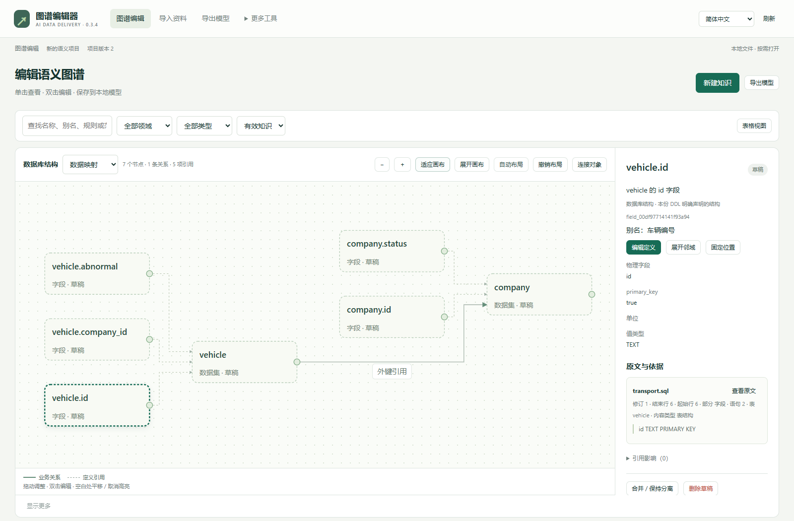

# AI Data Delivery

**把已有表结构变成可编辑、可交给 Agent 的语义模型。**

[English](README.md) · [下载 0.3.6 ZIP](https://github.com/franklinxkk/ai-data-delivery/releases/tag/v0.3.6) · [安全说明](SECURITY.zh-CN.md)

导入 SQL，或读取数据库目录，先得到表、字段和外键草稿；再补充“车辆、企业、线路”等业务对象、属性与关系。导出一份带来源的语义包，其他本机 Agent 可以直接用 CLI 读取。

**CLI 是主入口，浏览器只是按需打开的图谱编辑器。** 无需账号、常驻服务、Neo4j 或模型密钥。适合想复用已有数据结构、逐步补充业务含义的数据团队与 Agent 开发者。宿主 Agent 负责理解业务资料，本工具负责保存、编辑和交付模型。

`导入结构 → 按需查看／编辑 → 导出或本地读取`



*实际界面，使用随包提供的合成交通表结构。虚线节点表示草稿，物理外键不自动解释为业务归属。*

**和 Agent 一起画图：** 初次生成结构、补完一组业务关系或修改主体口径时，让宿主直接显示同一项目的图。打开后可用“新建对象 / 新建关系”，选择业务域、连接类型和端点。空闲页面会同步 Agent 的保存；编辑中的表单不会因同步被替换。可先存草稿，确认时再补定义、范围和来源。已有资料请用“引用已导入原文”。

## 两条命令，得到第一份模型

下载 ZIP，解压后进入 `ai-data-delivery` 目录。需要 **Python 3.10+**，首次安装依赖：

```bash
python -m pip install -r requirements.txt
```

导入随包示例，再导出草稿：

```bash
python -X utf8 scripts/knowledge.py --project "./work/transport" --language zh import --file "examples/semantic-workbench/transport.sql" --seed-draft
python -X utf8 scripts/knowledge.py --project "./work/transport" export --out "./work/transport.zip" --draft
```

得到 **2 张表、5 个字段、1 条外键**及原文依据，不会执行 SQL，也不会猜测业务规则。将文件路径换成自己的 DDL 即可。`--seed-draft` 仅初始化空模型；已有模型再次导入时去掉该参数，通过候选核对结构变化，保留人工修改。

`--draft` 允许未确认的模型用于继续建模，包内会明确保留草稿与缺口。核对并确认定义后，可去掉 `--draft` 导出确认快照。输出文件必须尚不存在，防止覆盖旧包。

Windows 若 `python` 不可用，用 `py -3 --version` 检查后将命令中的 `python` 换成 `py -3`；已有虚拟环境则使用其中的 Python。

## 需要看图时，再打开

```bash
python -X utf8 scripts/start.py --project "./work/transport" --language zh
```

打开终端给出的本机网址，直接进入图谱。仅有表结构时自动显示数据视图。单击看来源，双击改定义，拖动连线补充关系；修改可以保存草稿，也可以在核对后确认。CLI 与界面读写同一个本地模型。

完成后可在 **导出模型** 下载语义包，关闭页面并在终端按 **Ctrl+C** 停止编辑服务。重新打开仍用同一路径。只用 CLI 时无须启动服务；不需要先建立业务问题或走验收流程。

## 给本机 Agent 使用

```bash
python -X utf8 scripts/semantic_read.py --package "./work/transport.zip" search --query vehicle
```

读取器返回结构化 JSON；从搜索结果取实际 ID，再调用 `get`、`neighbors`、`context`、`sources` 读取定义、关系、依赖和原文。只需包文件，不依赖原项目或编辑器服务。[读取命令与边界](references/agent-reader.md)

也可以直接对宿主说：

> 使用 ai-data-delivery，把这份 SQL 导入指定目录，先生成结构草稿。结合我提供的业务说明补充车辆、企业和线路的含义，保留来源；只有需要我判断的地方再问。需要看关系时打开图谱，最后导出给其他 Agent 使用。

宿主处理命令、ID 与 JSON，你只核对业务含义。它不会把“外键引用”自动确认为“企业拥有车辆”。

补业务语义时，Agent 可把对象、属性、映射和关系一次成组保存；`inspect` 会提示未确认依赖、遗漏映射及跨表连接字段。你只需要判断资料中没有确定的业务含义，已有授权不重复确认。[建模短链与实际命令](references/modeling.md)

## 按需继续

| 需要做什么 | 使用入口 |
| --- | --- |
| 直接连接 SQLite、PostgreSQL、MySQL | [目录接入](references/readonly-metadata.md)：明确选表，只读结构，不读取业务行 |
| 补充文档、指标、规则或业务映射 | [建模短链](references/modeling.md)：成组维护、核对依赖，再按范围交付 |
| 把特定问题连同语义交给 Agent | [可选问题交付](references/question-delivery.md)：`handoff` 导出，`brief` 读取 |
| 将模型交给 Neo4j 或 ontology-graph-spec | [离线交换](references/neo4j-interop.md)：Neo4j 不是必装依赖 |
| 试交通、农业、高校、金融场景 | [四域合成练习](examples/cross-domain/README.md)，不代替实际业务制度 |

它提供本体建模与交付工具，不承担多人协作管理、企业权限、生产查询或业务执行。核心解析和离线读取在本机；可选数据库连接使用明确授权的端点。文件解析有范围限制，语义包可能包含业务定义与引用片段。[架构](references/architecture.md) · [实际验证](references/v0.3.6-release-validation.md)

0.3.6 支持打开图谱后同步查看 Agent 的修改；数千项资产的单次取证默认只返回相关内容。CLI 修改已有对象时须传入实际读取时的修订号，避免旧稿覆盖他人的编辑。已有模型不会自动迁移或覆盖；升级前保留备份。欢迎提交具体操作中卡住的步骤和脱敏材料：[反馈](https://github.com/franklinxkk/ai-data-delivery/issues)。

[MIT](LICENSE) · [Skill 指令](SKILL.zh-CN.md) · [改动历史](CHANGELOG.md)
