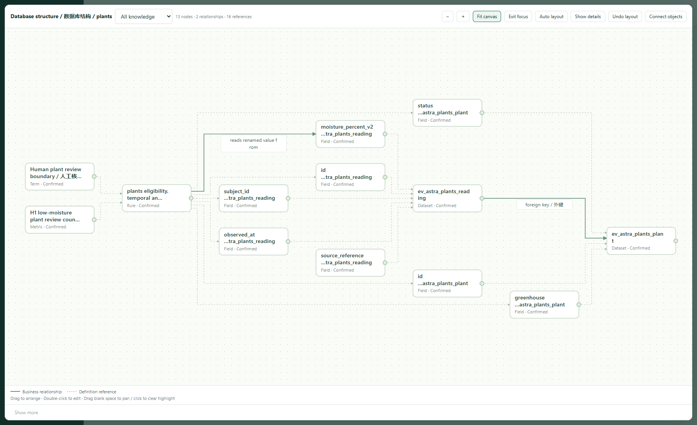
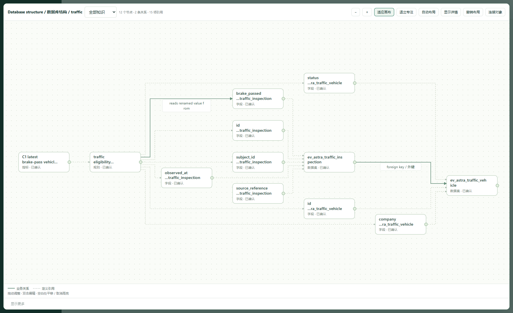
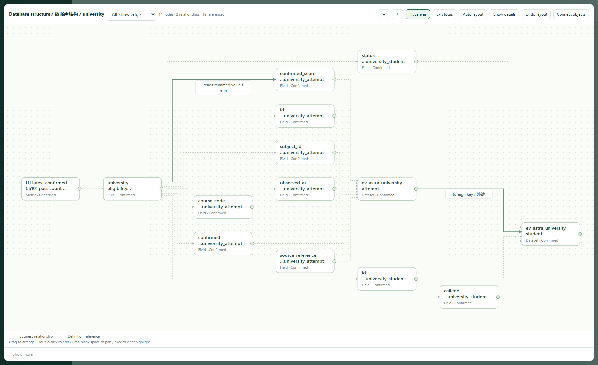
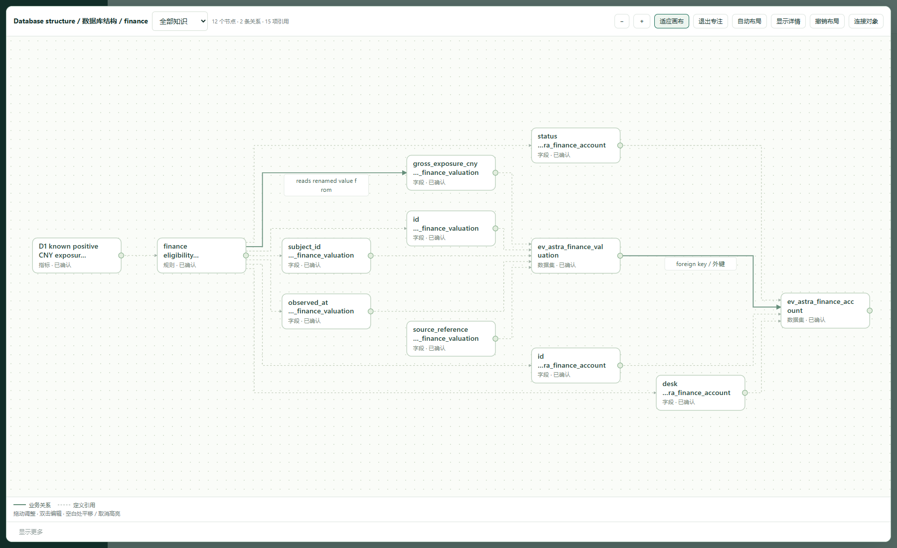

# v0.3.3 · three-model, four-domain validation / 三模型四领域验证

Date: 2026-11-14. Starting baseline: `6cdc35d86de321a97d272551426fdddd1136f94e` (v0.3.2). The installed baseline archive was hash-checked before testing. Final changed runtime was retested from an extracted v0.3.3 development archive; release files are checked against that runtime when packaging.

本轮由实际调用的 **gpt-6.1-terra、gpt-6.1-sol、gpt-6-astra** 分别执行，不是协调者模拟三种角色。每个模型先独立阅读安装版 skill、公开契约和新编双语原始材料，再建模、核对和交付。随后按 terra→sol、sol→astra、astra→terra 读取另一位作者的四份包，不提供作者答案。数据库、账户、表、项目和观察均为隔离的合成练习。

## Actual coverage / 实际覆盖

| Model / 模型 | Plants / 植物 | Traffic / 交通 | University / 高校 | Finance / 金融 |
|---|---|---|---|---|
| gpt-6.1-terra | SQLite | PostgreSQL | MySQL | SQLite |
| gpt-6.1-sol | PostgreSQL | MySQL | SQLite | PostgreSQL |
| gpt-6-astra | MySQL | SQLite | PostgreSQL | MySQL |

All 12 author projects completed the relevant chain: raw business text and physical structure → candidate review → canonical graph → actual value-column rename → impact paths → explicit retirement/rebinding using a synthetic administrator migration declaration → current question checks and recorded observations → confirmed handoff → standalone reader → Neo4j export and actual local import. Rejected or superseded candidates were not silently reaccepted. Old observation fingerprints were refused or marked stale. Sol and Astra additionally exercised nonunique-index automatic synchronization; Terra and Astra exercised added columns.

12 个项目均走通对应主链。每个领域同时覆盖三种目录源；连接器只读结构，未读取业务行。用于计算的观察由单独的测试数据工具读取，再由消费者本地计算。回归覆盖模型各自声明的条件：terra 的记录案例是一个范围外主体排除反例；sol、astra 还记录了独立样例计算。`recorded_pass` 是测试操作者的实际观察记录，**不是机器证明答案或真实客户签署**。发布清除已处理范围后，再运行目录回归返回 `not_applicable`，不能把它计成新的变更回归通过。

## Independent answers / 独立调用结果

All three cross-consumers agreed on the supplied rows after reading scope, temporal rules, dependencies and original evidence:

| Question / 问题 | Result from separate synthetic observations / 单独模拟观察的结果 | Preserved limits / 保留的边界 |
|---|---|---|
| Active plants in greenhouse H1 requiring low-moisture review / H1 在养植物低含水率核对 | 1 known plant, ID 2 / 已知 1 株，ID 2 | ID 4 unknown; latest reading only; no automatic watering / ID 4 未知，只用最新记录，不授权自动浇水 |
| In-service C1 vehicles passing the exercise brake condition / C1 在役车制动条件 | 1 known vehicle, ID 1 / 已知 1 辆，ID 1 | ID 4 unknown; dispatcher approval still required / ID 4 未知，仍须调度批准 |
| U1 enrolled students passing CS101 / U1 在籍学生 CS101 通过人数 | 1 known student, ID 2 / 已知 1 人，ID 2 | Filter course and confirmation before latest attempt; ID 4 unknown / 先筛课程与确认状态再取最新成绩，ID 4 未知 |
| D1 active accounts, positive exposure / D1 活跃账户正向敞口 | Known subtotal 100 CNY / 已知小计 100 元 | ID 4 unknown, so no complete total; negatives contribute zero, not an offset; no trading authority / 不报完整总额，不把负值抵扣，不授权交易 |

Each package reader returned `requires_execution`, disclosed `NO_DATA_CONNECTOR`, and retained `answer_verified:false`. It did not run a business query or perform an action. The traffic brief has a Chinese “截至” / English “before” ambiguity for a record exactly at the cutoff; existing observations do not contain equality, and this boundary was disclosed rather than invented. These are focused test questions, not complete industry ontologies or financial/regulatory advice.

## Findings and fixes / 发现与修复

| Finding / 问题 | Final behavior and evidence / 最终行为与证据 |
|---|---|
| Public candidate documentation omitted exact property names; two models used `conditions/requirements` and hit confirmation errors / 未列出准确属性名 | Contract now lists `condition/requirement`, all metric keys and their meaning. Public CLI `review/edit` uses the same graph, revision, provenance and disposition guards. Wrong keys, out-of-group assets, stale revision and rejected candidates remain rejected. / 补齐字段契约及宿主命令，拒绝与修订守卫保留。 |
| Local HTTP session acquisition was hard to discover / 本地接口会话用法不清 | Documented session meta/header/origin lifecycle; ordinary host authoring can use CLI without reverse-engineering the browser. / 公开本地会话方法，常规宿主可直接用 CLI。 |
| Definition applicability confused with the data cutoff / 定义日期与取数截点混淆 | Bilingual skill, docs and form separate `as_of` from metric `time_scope`; no fabricated validity dates. / 双语入口及文案已区分，不虚构有效期。 |
| After a prior publication cleared catalog dirty scope, an unresolved requested definition date could still produce a confirmed question package / 已发布后可绕过定义日期检查 | Every confirmed question handoff now checks the full dependency closure's validity on the requested date. Sol reproduced the original sequence: structured rejection, no new snapshot/file; explicit draft preserves gaps. Terra also checked a separate refusal case. Recovery retains the actual data cutoff. / sol 原路径复验，拒绝无副作用，明确草稿仍可保留待核对项。 |
| Neo4j omitted direct edges for `kind=mapping` / Neo4j 漏 mapping 有向边 | Export includes both relation and mapping edges. Astra re-exported all four packages and imported each twice: correct ID, endpoints, direction and predicate, no duplicates. Coordinator separately read stored `relation_type=maps_to` and matched all four CSV rows. Terra also verified an independent mapping. / 四域实际导入及重复导入，另读回关系类型，不以资产 JSON 存在替代有向边核对。 |
| Shared connection-name prefixes hid the actual column names / 相同连接名前缀遮住字段名 | Graph nodes prioritize column/table labels while preserving full identity in tooltip/details and authored custom names. Actual browser screenshots show all four renamed value columns. / 显示实际字段及表名，完整身份和自定义名称保留。 |

The earlier Neo4j Chinese-garbling observation was a PowerShell output-decoding error, corrected in the test harness; it is not claimed as a product defect. A historical cross-domain test intentionally requested an expired definition date but expected a confirmed handoff; it now proves confirmed refusal and explicit draft preservation rather than weakening the new guard.

## Execution evidence / 执行证据

- Python suite: **448 run, 443 passed, 5 skipped**. Skips are Windows symbolic-link privilege checks; they are not counted as passed. / 5 项是 Windows 符号链接权限限制。
- Existing JavaScript state, bilingual-label and graph-geometry checks passed; changed scripts parsed successfully. Geometry tests remain separate from browser inspection. / JS 状态、双语、图几何与语法检查通过，不代替浏览器验收。
- Actual local Edge browser screenshots were captured from final changed runtime; no image generation or injected result panels. / 真实工作台截图，未生成示意图或注入验收结果。
- Live PostgreSQL 18.7, MySQL 8.4.13, SQLite and Neo4j Community 5.26.33 were used in the isolated lab. / 使用实际本地数据库。
- See [sanitized stored mapping check](https://github.com/franklinxkk/ai-data-delivery/blob/main/maintainer/evidence/v0.3.3/stored-mapping-verification.json). Full local raw command outputs, first failures, retests and model reports are retained separately; credentials and project databases are excluded from the installation archive. / 原始本地证据与安装包分开。

No production business query, ongoing CDC subscription, complete industry coverage, external security certification, ClawHub scan or SkillHub evaluation is claimed by these results. / 本次没有生产查询、持续 CDC、完整行业覆盖或外部平台安全认证。

## Actual graph screenshots / 实际图谱截图

These are Astra's final workbench graphs, including physical structure and explicit mappings after rename. Dashed lines are definition dependencies; solid lines retain declared relation direction. The complete workbench graph can include assets outside a selected question package. / 以下为 astra 最终工作台全图；虚线是定义引用，实线是有向关系，全图可能包含问题包范围之外的资产。

